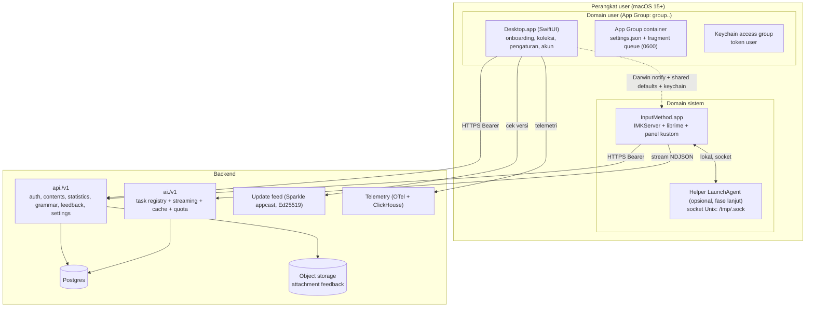

# 01 — Arsitektur referensi & topologi proses

## 1. Bentuk final yang saya rekomendasikan **[BLUEPRINT]**



## 2. Batas tanggung jawab

| Proses      | Memiliki                                                                                                               | Tidak boleh                                                                                                |
| ----------- | ---------------------------------------------------------------------------------------------------------------------- | ---------------------------------------------------------------------------------------------------------- |
| Desktop app | identitas user, onboarding & izin instalasi, viewer koleksi, editor pengaturan, update app                             | ikut serta di jalur kritis pengetikan (latensi), menyimpan token di file plaintext                         |
| IME agent   | engine input, render panel kandidat & panel aksi, pembacaan seleksi host, panggilan AI, tulis fragmen ke antrian lokal | menyimpan rahasia di `UserDefaults`, menulis ke path global tanpa validasi, spawn proses shell per-request |
| API backend | auth & sesi, CRUD konten, statistik, pengaturan berversi, rilis                                                        | jadi bottleneck mengetik (harus bisa offline)                                                              |
| AI gateway  | task registry, prompt, routing model, cache, quota, safety                                                             | menyimpan teks non-koleksi lebih lama dari TTL yang dijanjikan                                             |

**[KEYSAKE]** pemetaan proses Keysake ke bentuk ini: `ai.tygo.app` (app), `ai.tygo.inputmethod.input`/`TygoInputController`
(IME, `LSBackgroundOnly`+`LSUIElement`), `install.sh` via `do shell script … with administrator privileges` atau
`AuthorizationExecuteWithPrivileges` (instalasi), dan `~/Library/Rime/scripts/rime_ai_*.py` (jembatan AI) — semuanya
terbukti di DMG/pseudocode.

## 3. IPC antar proses: pilih yang ini **[BLUEPRINT]**

1. **Pengaturan & event = Darwin notification** (persisten, tidak perlu daemon, sudah terbukti dipakai Keysake).
   Nama: `com.<reverse-dns>.settings.changed`, `.credential.changed`, `.collections.changed`, `.shortcut.<name>.changed`.
   Payload **tidak** lewat notification (Darwin notification tidak membawa data bermakna antar-app secara aman);
   notification hanya lonceng, isinya dibaca dari shared file.
2. **Kondisi = shared `UserDefaults(suiteName: "group.<tid>.<proj>")`** dengan **`settingsVersion: Int64` monotonic**
   supaya IME bisa idempoten (Keysake punya `SettingsCache` + invalidasi saat versi app berubah **[KEYSAKE]**).
3. **Rahasia = keychain dengan `kSecAttrAccessGroup = group.<tid>.<proj>`** dan `SecItem` class generic-password,
   `kSecAttrAccessibleAfterFirstUnlockThisDeviceOnly`. Keysake memakai group `group.ai.tygo` **[KEYSAKE]**.
4. **Antrian fragmen = file append-only + lock file** (Keysake punya `FragmentStore` + `FragmentFileLock` +
   `FragmentSnapshotStore` **[KEYSAKE]**). Format baru: satu file JSONL `pending.ndjson` mode `0600`, rename-atas-atomik,
   jangan chmod 775 ke group `staff` (lihat 07).
5. **Jalur AI frekuensi tinggi = Unix domain socket ke helper** (fase lanjut, lihat 04 §7). Jangan spawn `/usr/bin/python3`
   per aksi seperti Keysake **[KEYSAKE]** — itu membebani proses, bocor di `ps`, dan rapuh secara keamanan.

## 4. Struktur modul klien yang saya sarankan **[BLUEPRINT]**

Pecahan ini meniru batas yang terbukti work di Keysake (nama modulnya: `Tygo`, `TygoInput`, `TygoNetwork`,
`TygoBase`, `AccountService`, `InputInstaller`, `MacShared`, `Logging` **[KEYSAKE]**) tapi dengan nama netral:

```
Packages/
  CoreKit/            // tipe domain, error, IDs, versi skema
    Models/           Content, FragmentSnapshot, GrammarAnalysis, DeviceProfile
    Storage/          KeychainStore, SharedSettings, FragmentQueue, FileLock
    Net/              APIClient, RequestEnvelope, RetryPolicy, TokenProvider
    Log/              os.Logger subsystem per-modul
  AccountKit/         // Sign in with Apple (native + web PKCE), sesi, hapus akun
  InputKit/           // IMKServer, Controller, EngineBridge(librime), CandidatePanel, ActionBar
  InstallerKit/       // staging payload, verifikasi, instalasi, registrasi TIS, diagnostik
  TranslationKit/     //Translation.framework session + status language pack + fallback
  AIBridgeKit/        // task registry klien, cache lokal, streaming reader
  DesktopApp/         // SwiftUI: onboarding, koleksi, pengaturan, profil, feedback, update
  SharedUI/           // komponen, token visual, aset panduan
```

Aturan: **`InputKit` tidak boleh meng-import `DesktopApp`**, dan hanya boleh menyentuh `CoreKit` + `AIBridgeKit` +
`TranslationKit`. Ini yang menjaga jalur mengetik tetap ringan dan membuat IME tidak bisa merusak UI app.

## 5. Identitas & kemasan yang perlu kamu putuskan sejak hari pertama **[BLUEPRINT]**

| Hal                                | Nilai contoh                         | Kenapa penting                                                                                                              |
| ---------------------------------- | ------------------------------------ | --------------------------------------------------------------------------------------------------------------------------- |
| App ID base                        | `com.<brand>.`                       | App Group, keychain group, dan ID input source diturunkan dari sini; mengubahnya setelah rilis = data user hilang           |
| Bundle app                         | `com.<brand>.app`                    | Developer ID + notarization                                                                                                 |
| Bundle IME                         | `com.<brand>.inputmethod`            | TIS input source id = `<bundle>.<modeId>`, tidak boleh berubah **[VERIFY: perilaku macOS bila id berubah]**                 |
| `InputMethodConnectionName`        | `<bundle>_Connection`                | nama koneksi IMKServer; harus sama dengan yang didaftarkan                                                                  |
| `InputMethodServerControllerClass` | `IMEController` (ObjC-visible Swift) | Keysake: `TygoInputController` **[KEYSAKE]**                                                                                |
| Team identifier                    | dari Apple Developer                 | dipakai entitlement keychain group                                                                                          |
| Minimum OS                         | macOS 15.0                           | `Translation.framework` + `Locale.LanguageCode` stabil dari sini; cek batas bawah realistis untuk pasar target **[VERIFY]** |

Jangan meniru hal ini dari Keysake: nama internal publik vs internal berbeda (`ai.tygo.app` di-brand "Keysake"),
dua basis URL (`keysake.ai/api` dan `tygo.apps.wisebox.ai/api`) tanpa penamaan env yang jelas, dan dukungan
email memakai domain vendor lain (`care+keysake@sider.ai`). **[KEYSAKE]** — semuanya membuat audit & kepatuhan
sulit; pakai satu domain milik sendiri dan beri nama env eksplisit (`prod`, `staging`).

## 6. Versi & build **[KEYSAKE]**

Keysake memakai app build `34` vs IME build `54` dengan `CFBundleShortVersionString` sama `1.0.0`. Artinya
**versi IME bergerak lebih cepat dari app**. **[BLUEPRINT]**: pakai satu `releaseChannel` di server yang memetakan
`(appMinVersion, imeVersion, engineResourceVersion, schemaVersion)` dan wajibkan klien memvalidasi keempatnya
sebelum memanggil API; simpan `manifest.json` + hash per artefak seperti yang dilakukan bundle Keysake (mereka
sudah benar di bagian ini: `Prebuilt/manifest.json` berisi SHA-256 tiap file).
