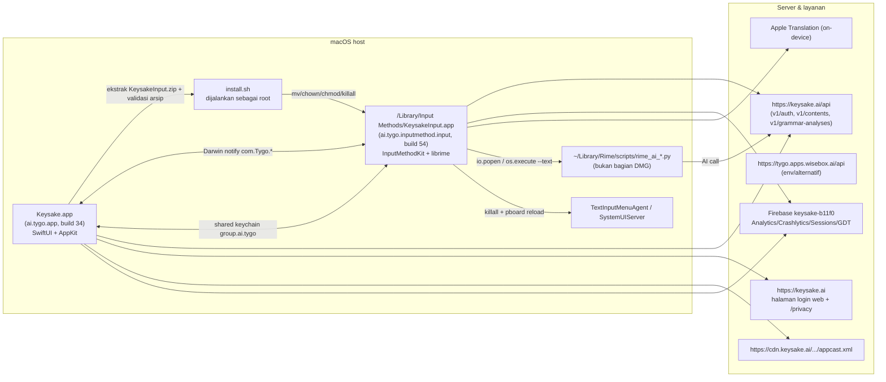

# Keysake untuk macOS — Riset Arsitektur & Analisis Produk Penuh

Target: `D:\waddle\.rea\refrence\Keysake.dmg` (92.920.212 byte, SHA-256 `9a047f73417146ac8b3585ef8f727fdb66635563677890fcd3bddd4d13f4dc08`).
Alat: REA CLI 6.5.0 (`inspect-artifact`), 7-Zip (ekstraksi DMG HFS+), parser Mach-O + Swift metadata buatan sendiri (Python/Capstone), Ghidra 12.2 headless (analisis penuh + decompilation 398 fungsi).
Tanggal riset: 2026-10-25. Semua klaim di bawah diberi penanda: **[OB]** observasi langsung dari file, **[IF]** inferensi dari observasi, **[UK]** belum terverifikasi.

---

## 1. Ringkasan produk

Keysake adalah **input method Mandarin (zh-Hans) "bilingual" untuk macOS yang menampilkan terjemahan Inggris langsung di panel kandidat**, dengan tagline _"打字可以学英语 / You can learn English by typing"_ **[OB]**. Nama internal proyeknya **Tygo** (bundle `ai.tygo.app`, modul Swift `Tygo`, `TygoInput`, `TygoNetwork`), nama publiknya Keysake, dan dukungan operasionalnya menunjuk ke **Sider.ai** (`care+keysake@sider.ai`) **[OB]**.

Empat kemampuan inti yang terbukti dari biner:

1. **IME Rime** — librime 1.17.0 + skema 雾凇拼音 (rime-ice/rime-frost) dibundel sebagai sumber daya pra-kompilasi, 33 modul Lua, satu process IME terpisah (`KeysakeInput.app`) **[OB]**.
2. **Terjemahan saat mengetik** — memakai **Apple `Translation` framework** (on-device, butuh unduh "language pack" zh↔en dari System Settings), bukan server **[OB]**.
3. **"AI box" di dalam kandidat** — empat tugas AI (译英/译中/改写/文献) yang dieksekusi lewat **jembatan Lua → script Python → HTTP**, dengan pekerja asinkron dan panel hasil di dalam candidate window **[OB]**.
4. **Kolase/arsip potongan teks ("收藏/收录")** — tombol bintang untuk menyimpan fragmen yang baru diketik/dipilih, sinkron ke server, ditelusuri per tanggal di app pendamping **[OB]**.

App utama (`Keysake.app`) adalah **installer + onboarding + viewer + settings + akuntansi**, bukan tempat mengetik. IME adalah agen latar belakang (`LSBackgroundOnly`, `LSUIElement`) yang membaca pengaturan dari app lewat **Darwin notifications** dan kredensial lewat **shared keychain** **[OB]**.

Distribusi: **Developer ID Application: Vidline Inc. (DY69LKWHQV)**, bukan Mac App Store, update via **Sparkle** (`https://cdn.keysake.ai/releases/macos/appcast.xml`, kunci Ed25519 `ZZvnLbwLvk3zaUY70EfEtRyPWtiEE4iomUD/D+MDr4o=`) **[OB]**.

---

## 2. Peta makro: siapa bicara dengan siapa



**[OB]** untuk semua panah kecuali `PY --> API` (lihat catatan **[UK]** di §7.3).

### 2.1 Mekanisme IPC antar proses (terbukti)

- Simbol impor `_CFNotificationCenterGetDarwinNotifyCenter`, `_CFNotificationCenterPostNotification`, `_CFNotificationCenterAddObserver`, plus `_OBJC_CLASS_$_NSDistributedNotificationCenter` ada di **kedua** biner **[OB]**.
- Nama kanal yang direferensikan kedua biner:

| Kanal                                             | Pengirim terduga | Konsumen             | Fungsi                                    |
| ------------------------------------------------- | ---------------- | -------------------- | ----------------------------------------- |
| `com.Tygo.settingsChanged`                        | app              | IME                  | aplikasikan ulang `RimeUserConfiguration` |
| `com.Tygo.displaySettingsChanged`                 | app              | IME                  | urutan/ukuran font kandidat               |
| `com.Tygo.inputModeShortcutChanged`               | app              | IME                  | tombol switch zh/en                       |
| `com.Tygo.collectionShortcutChanged`              | app              | IME                  | shortcut kolektor fragmen                 |
| `com.Tygo.collectionsChanged`                     | IME/app          | app                  | refresh daftar 收录                       |
| `com.Tygo.credentialDidChange`                    | app              | IME                  | token login baru                          |
| `com.Tygo.NetworkClient.credentialInvalid`        | jaringan         | app/IME              | paksa re-auth                             |
| `com.Tygo.AccountService.didLogin` / `.didLogout` | AccountService   | model & sinkronisasi | reset cache                               |

**[OB]** (string + tabel referensi fungsi, lihat `evidence/05`, `evidence/07`).

- Kredensial disimpan di **keychain access group `group.ai.tygo`**; error UI-nya eksplisit: "无法保存登录凭证，请检查应用签名与共享钥匙串权限后重试" **[OB]**.
- App group/entitlement: profil penyediaan berisi `com.apple.security.application-groups`, `com.apple.developer.team-identifier`, `keychain-access-groups` **[OB]**.

---

## 3. Inventaris paket

| Komponen         | Path                                                                         | Ukuran                                 | Catatan                                       |
| ---------------- | ---------------------------------------------------------------------------- | -------------------------------------- | --------------------------------------------- |
| App utama        | `Keysake.app/Contents/MacOS/Keysake`                                         | 11,9 MB universal (x86_64+arm64)       | 46 dylib, tidak terenkripsi, Developer ID     |
| Framework bawaan | `Contents/Frameworks/{Sparkle, FirebaseAnalytics, GoogleAppMeasurement}`     | —                                      | `@rpath/Sparkle.framework/Versions/B/Sparkle` |
| Payload IME      | `Contents/Resources/InputMethod/KeysakeInput.zip`                            | 86 MB (229 MB hasil ekstrak, 759 file) | divalidasi sebelum install                    |
| Meta IME         | `Contents/Resources/InputMethod/InputMethodInfo.plist`                       | 3,5 KB                                 | dibaca installer untuk registrasi             |
| Skrip root       | `Resources/InputInstaller_InputInstaller.bundle/…/install.sh`                | 3,4 KB                                 | lihat §6                                      |
| Config Firebase  | `Contents/Resources/GoogleService-Info.plist`                                | —                                      | PROJECT_ID `keysake-b11f0`, API key publik    |
| Font             | `GochiHand-Regular.ttf`, `MacShared.bundle/Figtree.ttf`                      | —                                      | dipakai UI kandidat/app                       |
| Gambar panduan   | `InputEnableGuides.png`, `Assets.car` (68 nama aset)                         | —                                      | lihat §8                                      |
| IME              | `KeysakeInput.app/Contents/MacOS/KeysakeInput`                               | 17,1 MB universal                      | InputMethodKit, librime statis                |
| Mesin Rime       | `InputEngine_InputEngine.bundle/Contents/Resources/{Rime,Prebuilt,Licenses}` | ~95 MB                                 | tabel pra-kompilasi + 33 Lua                  |

Versi & build: app `CFBundleShortVersionString 1.0.0 / CFBundleVersion 34`; IME `1.0.0 / 54`; dibangun dengan **Xcode 26.3 (17C529), SDK macOS 26.2**, `LSMinimumSystemVersion 15.0`, mesin build `macOS 24G90` **[OB]**.
Jejak developer: `/Users/th2/Documents/work/Tygo/build/DMGDerivedData/...` (app) dan `/Users/avery/Desktop/RESEARCH/Tygo/rime-source/librime/...` (mesin Rime) **[OB]**.

Arsip DMG punya **386 alternate stream** HFS+ — artinya resource fork/symlink macOS dipertahankan; 4 item gagal diekstraksi 7-Zip di Windows (kemungkinan symlink/Finder metadata), tanpa dampak pada biner **[OB]**.

---

## 4. Lapisan kode (Swift)

Pemetaan modul dari metadata ObjC/Swift + jalur sumber yang tertinggal di biner **[OB]** (daftar lengkap: `evidence/01`, `evidence/02`).

### Keysake.app — 424 tipe, 53 protokol

| Modul            | Kelas/struktur kunci                                                                                                                                                                                                                                                                                                                                                                               | Peran                                          |
| ---------------- | -------------------------------------------------------------------------------------------------------------------------------------------------------------------------------------------------------------------------------------------------------------------------------------------------------------------------------------------------------------------------------------------------- | ---------------------------------------------- |
| `Tygo` (app)     | `TygoApp`, `TygoAppDelegate`, `ContentView`, `SettingsWindowView`, `SettingsSidebarView`, `SettingsModel`, `LibraryModel`, `LibraryHistoryModel`, `LibraryAccountSession`, `LibraryCollectionCache`, `InputInstallationModel`, `InputInstallationService`, `AppUpdateService`, `UpdateUserDriver`, `TranslationLanguageModel`, `CollectionScrollView`, `FeedbackTextEditor`, `PlaceholderTextView` | UI + orkestrasi                                |
| `AccountService` | `AccountService`, `AppleAuthorization`, `AppleWebAuthorization`, (+ `AppleWebLoginProof`)                                                                                                                                                                                                                                                                                                          | login Apple & web                              |
| `TygoNetwork`    | `NetworkClient`, `CredentialStore`, `FragmentStore`, `FragmentSync`, `FragmentFileLock`, `NetworkError`, `NetworkTimeout`                                                                                                                                                                                                                                                                          | API + antrian sinkronisasi                     |
| `InputInstaller` | `InputMethodInstaller`, `InputSourceController`, `MacInputSourceSystem`, `InputSourceChanges` (proto `InputSourceSystem`, `InputInstallationServicing`)                                                                                                                                                                                                                                            | install + registrasi TIS                       |
| `TygoBase`       | `Keychain`, `UserDefaultsKey` (proto)                                                                                                                                                                                                                                                                                                                                                              | penyimpanan aman/preferensi                    |
| `MacShared`      | `MacSharedFonts`, resource bundle                                                                                                                                                                                                                                                                                                                                                                  | aset bersama                                   |
| `Logging`        | `Logger`, `Lock`, `ReadWriteLock`                                                                                                                                                                                                                                                                                                                                                                  | logging (subsystem `ai.tygo.installation-log`) |
| Pihak ketiga     | Alamofire (statis), Sparkle (dinamis), FirebaseAnalytics/GoogleAppMeasurement (dinamis), KeychainAccess (`com.kishikawakatsumi.KeychainAccess.error`), KeychainStorage (`com.gul.KeychainStorage.*`), Promises, nanopb                                                                                                                                                                             | —                                              |

Proto penting: `LibraryAccount`, `TygoNetwork.Request`/`NetworkParameters`, `InputInstallationServicing`, `UserDefaultsKey`, `AuthenticationCredential`, `Authenticator` **[OB]**.

### KeysakeInput.app — 381 tipe

| Kelompok         | Tipe                                                                                                                                                                                                                                                                                                                                                                      |
| ---------------- | ------------------------------------------------------------------------------------------------------------------------------------------------------------------------------------------------------------------------------------------------------------------------------------------------------------------------------------------------------------------------- |
| Controller IMKit | `TygoInputController`, `InputAppDelegate`, `InputMain`, `Session`, `Screen`                                                                                                                                                                                                                                                                                               |
| Mesin            | `InputEngine`, `InputEngineError`, `RimeNotificationBridge`, `RimePrebuiltResources`, `RimeUserConfiguration`, `EngineNotification`, `InputDictionaryVariant`                                                                                                                                                                                                             |
| Panel kandidat   | `CandidatePanel`, `CandidatePanelView`/`CandidateCardView`, `CandidateCellView`, `CandidateGridView`, `CandidateLoadingView`, `ExpandCellView`, `CandidateTranslation`, `CandidateLayout`, `CandidatePanelPosition`, `CandidateCaretPlacement`, `CandidateDisplaySettings`, `CandidateFontSize`                                                                           |
| Panel fragmen    | `FragmentPanel`, `FragmentPanelView`, `FragmentPanelSurface`, `FragmentPanelTranslation`, `FragmentScrollView`, `FragmentDocumentView`, `FragmentCollectButton`, `FragmentLimitToastView`, `FragmentSnapshot`, `FragmentSnapshotStore`, `FragmentSubmission`, `FragmentTrackingSession`, `FragmentCollectionCoordinator`, `FragmentContentResolver`, `FragmentTextClient` |
| Terjemahan       | `InputTranslationSessionBroker`, `InputTranslationTaskHost`, `TranslationState`, `EmojiMappingStore`                                                                                                                                                                                                                                                                      |
| Jaringan/akun    | sama seperti app (`NetworkClient`, `CredentialStore`, `FragmentStore`, `FragmentSync`) + tipe request                                                                                                                                                                                                                                                                     |
| Pengaturan       | `PinyinSettings`, `CandidateDisplaySettings`, `SettingsStore`, `InputMode`, `InputModeShortcut`, `ModeSwitchKeys`, `CollectionShortcut`                                                                                                                                                                                                                                   |

---

## 5. Permukaan backend (API)

Base URL dipilih di satu fungsi konfigurasi (`0x1000e3000`): default `https://keysake.ai/api`, dengan cabang kedua ke `https://tygo.apps.wisebox.ai/api` **[OB]** — ada **override lingkungan** (`ServerEnvironment`, `ServerHost`, `RemoteConfigConstants`) dan flag statis (`DAT_100505910`) yang memilih salah satu; nilai default publik adalah keysake.ai **[IF]**.

Endpoint yang tampak sebagai literal di `__cstring` **[OB]** (`evidence/04`):

| Endpoint                                             | Pemanggil                    | Guna                                                                |
| ---------------------------------------------------- | ---------------------------- | ------------------------------------------------------------------- |
| `v1/auth/apple/challenge`                            | `0x1000cf06c`                | nonce untuk Apple identity token                                    |
| `v1/auth/apple/web/`                                 | `0x1000d1130`                | URL halaman login web (divalidasi skema+host)                       |
| `v1/auth/apple/web/exchange`                         | `0x1000d19d0`                | tukar ticket web → user token                                       |
| `v1/contents/statistics`                             | `0x1000d45c8`                | statistik mengetik (`ContentStatisticsRequest`)                     |
| `v1/contents/grammar-analysis`                       | `0x1000d7b70`                | analisis grammar (`AnalyzeGrammarRequest`)                          |
| `v1/grammar-analyses`, `v1/grammar-analyses/`        | `0x1000de2e0`, `0x1000d8028` | daftar/detail hapus hasil analisis                                  |
| `/settings`                                          | klien pengaturan             | unduh remote settings (`SettingsDownloader`, `SettingsCacheClient`) |
| `https://keysake.ai/privacy`, `…/wisebox.ai/privacy` | UI legal                     | tautan kebijakan                                                    |

Model request/response yang nama tipenya tertinggal di metadata **[OB]**: `AppleChallengeRequest/Response`, `AppleLoginRequest`, `AppleWebLoginRequest/Endpoint`, `SaveContentRequest`, `GetContentRequest`, `ListContentRequest`, `DeleteContentRequest`, `DeleteGrammarAnalysisRequest`, `ListGrammarAnalysesRequest`, `AnalyzeGrammarRequest`, `ContentStatisticsRequest`, `BatchRequest`/`BatchResponse`, `FeedbackRequest`/`FeedbackResponse`/`FeedbackImage`, `ProfileRequest`, `LogoutRequest`, `DeleteAccountRequest`, `HealthRequest`, `PingResponse`, `BusinessCodeResponse`, `GrammarAnalysis(List)`, `SavedFragment`, `ContentRecord`, `ContentDailyCount`, `RefreshState`.

Kontrak amplop: validator respons bernama `validate(_:response:data:userToken:)` **[OB]**, galat diklasifikasikan ke pesan lokal (fungsi `0x1000c7fa8`, `0x1000c7230`): `业务错误码：`, `无数据错误码：`, `网络超时错误：请求超时`, `数据未找到错误：未找到请求的数据`, `获取 UserToken 异常：`, dan notifikasi `com.Tygo.NetworkClient.credentialInvalid` bila token ditolak **[OB]**.

Header/Content-Type: `application/json`, `Accept-Language`, `Accept-Charset`, `Accept-Encoding` (Alamofire) **[OB]**. Tidak ditemukan bukti certificate pinning milik Keysake (hanya evaluator trust Alamofire yang tersedia, dan string `Certificate pinning failed for host` milik pustaka) → **[IF]** verifikasi TLS standar sistem.

Kredensial: `accessToken`, `identityToken`, `credentialVersion`, `_authToken`, `accountID` muncul di nama properti refleksi **[OB]**; penyimpanan lewat `CredentialStore` + `Keychain` (group `group.ai.tygo`) **[OB]**. Ada saklar pengembangan `desktopMockLoginToken` (2 lokasi: `0x10002e908`, `0x10002ecc4`) **[OB]**.

---

## 6. Alur instalasi (rantai paling kritis)

Dibuktikan dari string + decompilation `0x1000b2464` (native) dan `0x1000a0b1c`–`0x1000ae9c0` (controller input source) serta isi `install.sh` **[OB]** (`evidence/10`).

1. **Sumber payload**: `Contents/Resources/InputMethod/KeysakeInput.zip` → `KeysakeInput.app/` (juga recognized legacy name `TygoInput.app`).
2. **Ekstraksi + validasi arsip** (fungsi `0x1000b4550`, memakai `libarchive`): tolak `归档包含不支持的文件类型`, `归档包含绝对链接`, `归档包含越界路径或硬链接`, `归档链接越界`, `归档路径过长`, dan wajib `归档顶层必须为 KeysakeInput.app` **[OB]** — ini guard path-traversal yang serius.
3. **Validasi berkas &签名**: pesan `输入法文件、版本或签名校验失败，请重新安装。` dan `App 缺少输入法安装资源，请重新获取完整的 App。` **[OB]** → ada cek versi + kode signature sebelum install.
4. **Eksekusi root, dua jalur**:
   - Jalur AppleScript: `do shell script "… with administrator privileges"` dengan `"/bin/bash" -p "$1" "$2"` **[OB]** → inilah `keysake-installer` (label tool yang di-dlopen/dieksekusi).
   - Jalur native: `dlopen("/System/Library/Frameworks/Security.framework/Security")` + `dlsym("AuthorizationExecuteWithPrivileges")` + `AuthorizationCreate` + right `system.privilege.admin` **[OB]** (API yang Apple deprecated/marik ke jalur tidak terdokumentasi).
   - Kegagalannya dibedakan UI: `无法创建管理员授权请求。`, `已取消管理员授权。`, `无法创建原生管理员授权。`, `无法分配安装参数。`, `原生安装已启动，但未获得结果通道。`, `原生安装返回了无法解析的结果，请检查安装日志。`, `管理员安装脚本失败（`, `模拟输入法安装失败（INPUT_INSTALL_ERROR=1）` → **killing switch untuk QA** **[OB]**.
5. **Isi `install.sh`** (root): `killall -9 TygoInput KeysakeInput` (opsional), hapus legacy `TygoInput.app`, hapus `KeysakeInput.app` lama, `mkdir -p /Library/Input Methods`, `mv -f`, `chown -R root:staff`, `chmod -R 775`, `xattr -d -r com.apple.quarantine`, `killall System Preferences`/`System Settings` (bila jalan) dan `killall SystemUIServer`; log ke `/private/tmp/keysake-install.XXXXXXXX/install_<ts>.log` **[OB]**.
6. **Registrasi & enable input source** (`InputInstaller`): baca `InputMethodInfo.plist`, tunggu notifikasi input source (`waiting for input source notification` → `input source notification received`), skip registrasi bila sudah enable (`already enabled; skip registration`), muat ulang menu input (`pboard reload`/`TextInputMenuAgent reload begin`, `after menu reload`), lalu `select Keysake begin/end`; fallback manual bila gagal: pesan `系统无法选择双语输入法。`, `系统未完成 ABC 键盘切换…`, `请启用双语输入法` + panduan `InputEnableGuides.png` + instruksi "System Settings → Keyboard → Edit → + → 双语" **[OB]**.
7. **Verifikasi pasca-install**: `安装完成后未检测到可用的输入法，请重新安装。`, diagnostik ditulis ke subsystem `ai.tygo.installation-log` (`安装诊断日志写入失败：%{public}s`) **[OB]**.
8. **Unduh bahasa (langkah 2 onboarding)**: memakai `TranslationSession.installedSource(...)` + `canRequestDownloads` **[OB]**; app hanya _memancing_ user ke System Settings (`LanguagePackDownloadGuide`, `LanguagePackProgressGuide`), dengan status `正在检查语言包…`, `语言包下载中...`, `语言包下载成功`, `语言包已就绪/未就绪`, `当前系统暂不支持中英翻译。`, `未来，我们将支持更多语言` **[OB]**.

---

## 7. Fungsi produk per area

## 7.1 Layar & state Keysake.app

Peta layar hasil penggabungan nama tipe View + cluster string per fungsi (`evidence/03`).

| Area                       | Layar/komponen                                                                                                                                                                                                                                                                               | Salinan UI (zh/EN)                                                                                                                                                                                                                                                                                                                                                                                         |
| -------------------------- | -------------------------------------------------------------------------------------------------------------------------------------------------------------------------------------------------------------------------------------------------------------------------------------------- | ---------------------------------------------------------------------------------------------------------------------------------------------------------------------------------------------------------------------------------------------------------------------------------------------------------------------------------------------------------------------------------------------------------- |
| Jendela utama              | `ContentView`, `SettingsWindowView` (dengan `SettingsTrafficLightLayout` kustom), `SettingsSidebarView`, `RefreshWindow`, `SettingsModalOverlay`                                                                                                                                             | ikon sidebar: `SettingsCollection`, `SettingsDisplay`, `SettingsFuzzyPinyin`, `SettingsLanguagePack`, `SettingsShortcuts`, `SettingsProfile`, `SettingsHistory`, `SettingsBrand`, `SettingsApple`, `SettingsMobile`, `SettingsCopy`, `SettingsDelete`, `SettingsMark`, `SettingsSwap`, `SettingsNext/Previous`, `SettingsChevron`, `SettingsClose`, `SettingsCalendarExpand`                               |
| Onboarding install         | `InputInstallationView` + state `InputFirstInstallView`, `InputInstalledView`, `InputNotAddedView`, `InputRemovedView`, `InputUpdateAvailableView`, `InputInstallationErrorView`, `InputInstallationHUDView`, `InputInstallationRecoveryToast`; HUD `HUDMessageView`/`HUDSurface`/`HUDStyle` | `第一步：安装双语输入法`, `安装输入法`, `安装输入法后，即可在任意应用中边打字边翻译。`, `双语输入法安装成功`, `输入法 & 语言包安装成功！`, `输入法安装中...`, `安装过程中遇到问题，点击重新安装或联系我们。`, `重新安装双语输入法`                                                                                                                                                                         |
| Onboarding panduan         | `CollectionIntroductionView`, `CollectionGuidePage`, `CollectionGuideSlide` (carousel "使用提示轮播", "张，共 2 张")                                                                                                                                                                         | `「Shift+空格键」 点击收藏图标`, `「Shift+空格键」 随时查看当前已输入的中英对照`, `打字过程中，可随时按下快捷键查看中英对照`, `单词、短语、句子或整段文本，都可收藏到app中查看回顾`, `显示多少，收藏多少`, `关闭使用提示`                                                                                                                                                                                  |
| Login                      | `LoginRequiredView`, `LoginProgressView` (+ `LoginIllustration`, `LoginProgressBackground`)                                                                                                                                                                                                  | `通过 Apple 登录`, `在浏览器窗口完成登录`, `登录后查看收录`, `登录正在进行中`                                                                                                                                                                                                                                                                                                                              |
| Koleksi/arsip              | `CollectionView`, `CollectionCalendarView`, `CollectionScrollView` (+observer), `LibraryEntryRow`, `LibraryEmptyView`, `CollectionPlaceholderView`                                                                                                                                           | `收录`, `我的`, `选择收录日期`, `你的中英文收录会按日期展示在这里。`, `当天暂无收录`, `正在拉取收录`, `中文已收藏，译文待补充`, banner: `CollectionLoading`, `CollectionRefresh`, `CollectionLoadFailure`, `CollectionBannerFavorite/Translation/Star/Hand/Panel/Close/Green`                                                                                                                              |
| Profil & akun              | `ProfileView` (+ `ProfileAvatar`, `ProfileAvatarBackground`), `DeleteAccountOverlay`                                                                                                                                                                                                         | `我的`, `确定删除账号吗?`, `账号正在删除中`, `请先登录账号`, `删除失败，请稍后重试`                                                                                                                                                                                                                                                                                                                        |
| Pengaturan — Display       | `DisplaySettingsView`, `CandidatePreview`, `PreviewFontSize`                                                                                                                                                                                                                                 | `显示`, `候选词显示顺序`, `调换候选词的中英文上下顺序`, `磅（12、14、16、18）`, `使用提示轮播`, `本地显示和拼音设置会保留。`                                                                                                                                                                                                                                                                               |
| Pengaturan — Pinyin/Fuzzy  | `PinyinSettings`, `FuzzySettingsView`                                                                                                                                                                                                                                                        | `模糊拼音`, `模糊拼音设置`                                                                                                                                                                                                                                                                                                                                                                                 |
| Pengaturan — Shortcut      | `ShortcutSettingsView`, `ShortcutGuide`, `ShortcutDemoCurrent/Sentence`                                                                                                                                                                                                                      | `快捷键`, `中英文切换快捷键`, `输入片段收藏快捷键`, `中/英键（Caps Lock）`, `」键切换中英文`, `系统使用中/英键切换输入法时，将遵循系统设置。左 Shift 仅在单独按下并松开时切换模式。`, `无效的收录快捷键：`, `快捷键示意：按 Shift 和空格查看输入与译文，点击面板右上角星标收藏。`, `光标在输入框内，随时按 Shift + 空格查看。内容收藏后不再显示，输入新内容后可再次查看。`, `重新读取配置`, `配置未保存：` |
| Pengaturan — Language pack | `LanguagePackSettingsView`, `TranslationLanguageStatusView`, `isLanguagePageVisible`                                                                                                                                                                                                         | `第二步：下载语言包`, `下载语言包，才可实现边打字，边翻译功能。且一次下载，无限使用。`, `在系统弹窗中分别下载中文和英文语言包`, `下载时间较长，可到系统设置>语言>翻译语言中查看进度，或重试下载`, `重新下载语言包`                                                                                                                                                                                         |
| Umpan balik                | `FeedbackView`, `FeedbackOverlay`, `FeedbackTextEditor`+`PlaceholderTextView`                                                                                                                                                                                                                | `反馈提交成功`, `请先登录后再提交反馈`, `任何想学习的语言、其它想法或问题，都可以反馈给我们`, `您的电子邮件（可选）`, `告诉我们您的电子邮件，以便更好沟通`, validasi `请输入正确的邮箱地址`, `邮箱地址不能超过 320 字节`, `提交失败，请检查网络后重试` (regex email `^[^@\s]+@[^@\s]+\.[^@\s]+$`)                                                                                                          |
| Update                     | `AppUpdateHUDView`, `AppUpdateService`, `UpdateUserDriver`, `AppUpdateButtonStyle`                                                                                                                                                                                                           | `有新版本输入法`, `双语输入法有新版本`, `更新后，体验更流畅，还可使用更多新功能，获取更好体验。`, `开始下载并安装更新`, `更新正在处理中`, `无法启动更新检查`                                                                                                                                                                                                                                               |

Kopi UI berbahasa Inggris yang tersedia hanya sedikit (`Typing can help you learn English`, `You can learn English by typing`, `Display as many as you favorite`) dan locale hanya `en`, `zh-Hans`, `zh-Hant` dengan `InfoPlist.strings` saja → **[IF]** terjemahan UI penuh dilakukan inline di kode, dan produk utamanya berorientasi pasar Tiongkok.

## 7.2 Perilaku IME (KeysakeInput)

- **Panel kandidat dwibahasa**: setiap kandidat menampilkan Tionghoa + terjemahan Inggris; ada opsi `englishFirst` (顺序上下), ukuran font terpisah `chineseFontSize`/`englishFontSize`, `CandidatePanelPosition`, `CandidateCaretPlacement`, `CandidateLoadingView` (`candidateTranslationLoading`), dan `ExpandCellView` untuk list panjang **[OB]**.
- **Mesin**: `InputEngine` membungkus librime; statusnya terlihat user: `Tygo：引擎已就绪`, `正在准备拼音，完成后继续输入…`, `引擎尚未就绪`, `引擎正在部署，请稍后重试。`, `拼音引擎启动失败`, `输入引擎无法启动部署`, `雾凇拼音方案加载失败`, `雾凇拼音或 Lua 模块加载失败`, `一个进程只能使用一个输入引擎用户目录。`, `运行中的引擎不能切换预编译资源或部署模式。`, `用户配置生成失败，无法应用当前设置。` **[OB]**
- **Resource**: `RimePrebuiltResources` memuat `Prebuilt/{rime_frost.table.bin 73 MB, prism, reverse, melt_eng.*}` + `manifest.json` berisi SHA-256 tiap artefak (verifikasi integritas) **[OB]**.
- **Skema & fitur Rime** (dari `default.yaml`/`rime_ice.schema.yaml`/`manifest.json`): page size 9, `Shift_L: commit_code` + `good_old_caps_lock: true`, key binder (`Tab`/`Shift+Tab`, `Alt+Left/Right`, `minus`/`equal` halaman, `Ctrl+Shift+3` ascii-punct, `Ctrl+Shift+4` traditionalization, numpad), select karakter `[`/`]`, translator tanggal (`rq/dt/sj/ts/xq`), `custom_phrase`, emoji via OpenCC, user dict cn_en untuk 8 gaya (abc, double_pinyin, flypy, jiajia, mspy, sogou, ziguang), plus skema `melt_eng` (Inggris) dan `radical_pinyin` **[OB]**.
- **33 modul Lua**, termasuk milik Keysake: `ai_box_processor/filter/view/actions/status_translator/trigger_processor`, `ai_translator`, `ai_clipboard_processor`, `tygo_emoji_filter/map`, `tygo_font_filter`, `tygo_json`, `mode_switch_processor`, `cold_word_drop/*`, `corrector`, `pin_cand_filter`, `long_word_filter`, `reduce_english_filter`, `is_in_user_dict`, `search`, `t9_preedit`, `select_character`, `calc_translator`, `number_translator`, `date_translator`, `lunar`, `autocap_filter`, `en_spacer`/`cn_en_spacer`, `force_gc`, `debuger`, `v_filter`, `unicode` **[OB]**.
- **Kolektor fragmen**: `TygoInputController` membuka `FragmentPanel` (jendela borderless dekat kursor). Sumber teks: selector IMKTextInput `attributedSubstringFromRange:` + `selectedRange` ada di biner IME dan modul bernama `FragmentTextClient`/`FragmentContentResolver` menangani resolusi teks host — **[IF]** (kehadiran selector terverifikasi, pemakaiannya tidak); jalur Accessibility pasti **tidak** dipakai karena tidak ada satu pun impor `_AX*` **[OB]**. Fallback tercatat: `使用输入法追踪片段（未从宿主范围读取）`; kegagalan dicatat per host: `收藏面板：无有效文字选区，宿主=%@`, `收藏面板：无法定位插入点，宿主=%@` **[OB]**. Tombol bintang `FragmentCollectStar`/`FragmentCollectedStar` menyimpan (`收藏输入片段`, `收藏这段内容`), ada batas (`FragmentLimitWarning`, `FragmentLimitToastView`), terjemahan menyusul (`无法补充收藏译文：%@`), dan sinkronisasi (`收藏正在同步，请稍后重试`, `无法保存本地收藏，请重试`, `账户已变化，请重试`) **[OB]**.
- **AI box (fitur generatif di dalam IME)** — `ai_box_actions.lua` mendeklarasikan 4 tugas: `translate_to_english` (译英), `translate_to_chinese` (译中), `paraphrase` (改写), `find_supporting_references` (文献). Eksekusi: jalur sinkron `io.popen("<python> scripts/rime_ai_bridge.py --config rime_ai.local.json --task … --text …")` dan jalur asinkron `os.execute("nohup <python> scripts/rime_ai_async_worker.py … --text-file <tmp> --status-prefix <tmp> &")` dengan status/spinner, file job di `tmp/ai_box_jobs/job-<epoch>-<n>`, separator hasil `\x19`, dan format error `prefix（label）：err` **[OB]**.

### 7.3 Catatan penting tentang jembatan AI

Script Python (`rime_ai_bridge.py`, `rime_ai_async_worker.py`, `rime_ai_clipboard.py`) dan konfigurasinya (`rime_ai.local.json`) **tidak ada di dalam DMG** — hanya direferensikan sebagai path `~/Library/Rime/scripts/…` oleh Lua **[OB]**. Artinya: (a) keduanya ditulis runtime oleh Swift/IME, (b) kredensial & endpoint AI berada di file JSON plaintext di home user, (c) isi prompt/model tidak dapat diverifikasi dari artefak ini **[UK]**.

## 7.4 Pengumpulan & penyimpanan data

| Data                  | Lokasi                                                                                                                                                                                                                                                       | Bukti                                            |
| --------------------- | ------------------------------------------------------------------------------------------------------------------------------------------------------------------------------------------------------------------------------------------------------------ | ------------------------------------------------ |
| Kredensial/user token | Keychain, group `group.ai.tygo`                                                                                                                                                                                                                              | string + `CredentialStore`, `Keychain`, error UI |
| Preferensi app & IME  | `UserDefaults` + Darwin notify, kunci terefleksi: `display`, `collection`, `pinyin`, `inputModeShortcut`, `collectionShortcut`, `fuzzyPairs`, `englishFirst`, `chineseFontSize`, `englishFontSize`, `firstInstall`, `isLanguagePageVisible`, `installation*` | `evidence/01`/`02`                               |
| Fragmen lokal         | `FragmentStore` + `FragmentSnapshotStore` (`snapshots`, `resolver`) + `FragmentFileLock`; status `pending`/`capacity`/`entries`                                                                                                                              | nama properti & fungsi                           |
| Remote settings       | `SettingsDownloader`/`SettingsCache` + `/settings`; invalidasi: `[Settings] Cache expired because app version changed`                                                                                                                                       | string                                           |
| Data Rime             | `~/Library/Rime` (user dir tunggal, `get_sync_dir`, `user_dict_sync`, `staging`, `sync`)                                                                                                                                                                     | string IME                                       |
| Log instalasi         | `/private/tmp/keysake-install.XXXX/install_*.log`; OSLog `ai.tygo.installation-log`                                                                                                                                                                          | install.sh + string                              |
| Telemetri             | Firebase Analytics + Crashlytics + Sessions + Installations + GoogleDataTransport; proyek `keysake-b11f0`                                                                                                                                                    | biner & plist                                    |

---

## 8. Pustaka, aset visual, dan legal

- Lisensi pihak ketiga tercantum di IME: **librime BSD**, **librime-lua BSD**, **OpenCC**, **LevelDB**, **Marisa**, **Darts-clone**, **Lua**, **yaml-cpp**, **RapidJSON**, **Boost**, plus `rime-frost-GPL-3.0.txt`, `rime-easy-en-LICENSE`, `rime-wubi-LICENSE`, `Unicode-LICENSE`, dan file `*-SOURCE.md` **[OB]** → kamus 雾凇 dibawa dengan **GPL-3.0**; kewajiban redistribusi sumber perlu dicek tim legal **[IF]**.
- Font: Gochi Hand (OFL, app), Figtree (OFL, MacShared), plus filter Lua `tygo_font_filter` → IME merender dengan font kustom **[OB]**.
- Aset utama (68 nama di `Assets.car`): `AppLogo`, `LoginIllustration`, `LoginGradientTop`, `ShortcutGuide`, `ShortcutDemoCurrent/Sentence`, `CollectionGuideCandidates/Keyboard/Menu/Pointer`, `LanguagePackDownloadGuide/ProgressGuide/Loading/Success`, `InputEnableGuides`, `AppUpdate*`, `CollectionBanner*`, `FragmentCollect/Collapse` (IME), `ProfileAvatar` **[OB]**.
- Legal/privasi: `https://keysake.ai/privacy`, `ITSAppUsesNonExemptEncryption = false` **[OB]**.

---

## 9. Penemuan keamanan & rekayasa (untuk ditindaklanjuti)

| #   | Temuan                                                                                                                                                                                   | Dampak                                                                                                                                 | Saran                                                             |
| --- | ---------------------------------------------------------------------------------------------------------------------------------------------------------------------------------------- | -------------------------------------------------------------------------------------------------------------------------------------- | ----------------------------------------------------------------- |
| 1   | Install root memakai `AuthorizationExecuteWithPrivileges` (via dlopen/dlsym) dan `do shell script … with administrator privileges`                                                       | API deprecated/tak terdokumentasi; rentan gagal di macOS baru; UX prompt ganda                                                         | `SMAppService`/`helper tool` sah + launch daemon ter-register     |
| 2   | `install.sh` memberi `chown -R root:staff` + `chmod -R 775` pada `/Library/Input Methods/KeysakeInput.app`                                                                               | Biner IME (yang berjalan di dalam proses aplikasi lain) writable untuk grup `staff` = semua user lokal → potensi substitusi/modifikasi | `root:wheel`, `755`, dan validasi kode signature saat load        |
| 3   | `xattr -d -r com.apple.quarantine` recursive; `killall` System Settings/SystemUIServer/TextInputMenuAgent; `rm -rf` dua path                                                             | Perilaku agresif pada mesin user; kehilangan state sistem UI                                                                           | minimalkan scope; jangan mematikan aplikasi sistem                |
| 4   | Guard arsip sudah baik (top-level wajib, no absolute link, no traversal/hardlink, tipe file, panjang path)                                                                               | Positif                                                                                                                                | tambahkan verifikasi kode/GPG atas zip + pin hash manifest di app |
| 5   | URL login web divalidasi skema **dan** host pada `0x1000d1130`                                                                                                                           | Positif (anti open-redirect)                                                                                                           | pastikan allowlist mencakup semua env & uji `keysake://` callback |
| 6   | Teks kandidat/user dikirim sebagai **argumen argv** ke proses Python (`--text …`)                                                                                                        | Isi ketikan terlihat di `ps`/log proses lokal                                                                                          | gunakan stdin/file dengan mode 0600 (jalur async sudah begitu)    |
| 7   | `rime_ai.local.json` + script Python di `~/Library/Rime` (plaintext, tidak ship di DMG)                                                                                                  | Kebocoran token AI; pasokan kode tidak terverifikasi                                                                                   | simpan di keychain, verifikasi integritas script                  |
| 8   | Lua membangun perintah shell dengan `shell_quote` sendiri                                                                                                                                | Risiko injeksi bila ada teks tak terduga (kamus/komentar)                                                                              | `posix_spawn` dengan argv array, hindari shell                    |
| 9   | Kontradiksi konfigurasi telemetri: `FIREBASE_ANALYTICS_COLLECTION_ENABLED=true`, `FirebaseCrashlyticsCollectionEnabled=true`, tapi `GoogleService-Info.plist IS_ANALYTICS_ENABLED=false` | Kepatuhan/consent tidak jelas                                                                                                          | satukan gerbang consent + tampilkan di UI                         |
| 10  | IME membaca seleksi host (`attributedSubstringFromRange:`) untuk kolektor fragmen                                                                                                        | Kapabilitas sensitif (semua app yang diketik)                                                                                          | dokumentasikan di kebijakan + batasi ke explicit action           |
| 11  | Kamus 雾凇 GPL-3.0 dibundel sebagai data + kode build (`CompileRime.swift`, `Tools/prebuild.sh`)                                                                                         | Kewajiban lisensi                                                                                                                      | audit lisensi + tautkan sumber                                    |

---

## 10. Keterbatasan riset & apa yang belum terbukti

- Riset **statis penuh**: biner di-strip (hanya 5 simbol tereksport, tanpa simbol lokal Swift), jadi fungsi Keysake di Ghidra bernama `FUN_*`; saya memetakannya lewat referensi string (adrp/add) agar bisa dibedah — tetapi **tidak ada eksekusi** yang diamati **[OB]**.
- Host Windows: provider REA hanya menerima PE/raw (`target_format_unsupported` untuk Mach-O) → Ghidra dijalankan manual; `rea decompile/function/trace` untuk Mach-O perlu diulang di macOS **[OB]**.
- **Belum terverifikasi**: payload/autentikasi sebenarnya dari tiap endpoint (`[IF]` dari nama tipe), isi `rime_ai.local.json` dan model AI yang dipakai, apakah `Translation.framework` dipakai untuk panel atau hanya untuk pre-download, penggunaan StoreKit (ter-link tetapi tidak ada product ID Keysake — kemungkinan hanya dependency Firebase), nilai `ServerEnvironment` default vs wisebox, dan apakah DMG di-notarize (perlu `spctl`/`notarytool` di macOS) **[UK]**.
- 4 item gagal ekstrak 7-Zip (kemungkinan symlink HFS+) — perlu `hdiutil`/macOS untuk memastikan tidak ada payload terlewat **[OB]**.

## 11. Langkah verifikasi berikutnya (butuh macOS)

1. `rea open_binary` + `rea inspect`/`decompile` pada `Keysake` (arm64) dengan provider Ghidra di macOS; lalu `rea trace_application_feature` untuk alur login & install.
2. `rea observe-native-calls` / `capture-native-ui-scenario` pada `Keysake.app` untuk merekam panggilan jaringan dan layar nyata.
3. Jalankan proxy (mitmproxy) saat login & koleksi untuk membuktikan payload `SaveContentRequest`, `ContentStatisticsRequest`, `AnalyzeGrammarRequest`.
4. Periksa `~/Library/Rime/scripts/*.py` + `rime_ai.local.json`, `~/Library/Application Support`, `~/Library/Group Containers/group.ai.tygo`, item keychain `group.ai.tygo`.
5. `codesign -dvvv`, `spctl -a -vv`, `notarytool history` untuk validasi notarization.

---

## 12. Cara kerja ulang riset ini (reproduksi)

```bash
# 1) Ekstrak DMG + payload IME
7z x -o.rea/work/keysake .rea/refrence/Keysake.dmg
7z x -o.rea/work/keysake-ime .rea/work/keysake/Keysake/Keysake.app/Contents/Resources/InputMethod/KeysakeInput.zip

# 2) REA: inventaris artefak (bukti ev_*)
rea inspect-artifact .rea/refrence/Keysake.dmg --format json
rea inspect-artifact .rea/work/keysake/Keysake/Keysake.app --format json   # 343 simpul, 370 sisi

# 3) Ambil slice arm64 (parser Mach-O langsung, LIEF 1.0-dev crash saat iterasi seksi kedua)
python .rea/work/analysis/thin.py <universal> ARM64 <out>

# 4) Ghidra 12.2 (butuh JDK 25) — analisis penuh + decompile per-daftar alamat
ghidra-headless.bat <proj> Keysake -import Keysake_arm64 -overwrite -analysisTimeoutPerFile 3600
ghidra-headless.bat <proj> Keysake -process Keysake_arm64 -noanalysis \
  -scriptPath <scripts> -postScript DecompList.java <addrs.txt> <outDir> <index.tsv>

# 5) Peta referensi string-per-fungsi (Swift memakai adrp+add, bukan pointer data)
python .rea/work/analysis/funcstarts.py <slice> <starts.txt>
python .rea/work/analysis/scan_strrefs.py <slice> <starts.txt> <strrefs.tsv>
python .rea/work/analysis/swiftmeta3.py <slice> <outdir>      # 424 tipe/53 protokol app, 381 tipe IME
```

Ghidra terpasang di `D:\waddle\.rea\tools\ghidra_12.2_PUBLIC` (+ JDK 25 `D:\waddle\.rea\tools\jdk-25.0.4.1+1`), launcher: [ghidra.bat](/c/Users/hi/bin/ghidra.bat) dan [ghidra-headless.bat](/c/Users/hi/bin/ghidra-headless.bat), `GHIDRA_INSTALL_DIR` sudah di-set untuk user. Proyek Ghidra aktif: `D:\waddle\rea-work\ghidra-proj\Keysake` dan `KeysakeInput`.

Bukti mentah, semuanya ada di dalam workspace:

- Laporan ini + blueprint pembangunan: `docs/keysake-research/` di repo ini ([blueprint/README.md](./blueprint/README.md))
- Inventaris & peta bukti (di luar repo, tetap di `D:\waddle\.rea
eports\evidence`) — `01-app-types.txt` (424 tipe), `02-ime-types.txt` (381 tipe), `03-app-string-clusters.md` (cluster string per fungsi = sidik jari layar), `04/05-keyword-functions.tsv`, `06/07-func-string-map.tsv` (2.957 + 5.236 baris pemetaan kode→string), `08/09-*-strings.txt` (UI Mandarin), `10-install.sh`
- Pseudocode Ghidra (398 fungsi): [dec-main](/D:/waddle/rea-work/dec-main), [dec-main2](/D:/waddle/rea-work/dec-main2), [dec-ime](/D:/waddle/rea-work/dec-ime)
- Bukti REA: evidence id `ev_fa5733d7…` (DMG, root SHA-256 terverifikasi) dan `ev_3e3e62f1…` (inspeksi `Keysake.app`: 343 artefak, 383 occurrence, 370 sisi graf).
- Skrip analisis yang saya tulis: folder [.rea/work/analysis/](/D:/waddle/.rea/work/analysis) (`machoparse.py`, `swiftmeta3.py`, `scan_strrefs.py`, `screen_clusters.py`, `pick_funcs.py`, `extract_strings.py`, `thin.py`) dan skrip Ghidra [.rea/work/ghidra-scripts/](/D:/waddle/.rea/work/ghidra-scripts) (`ReaProbe.java`, `DecompList.java`, `ListFuncs.java`).
